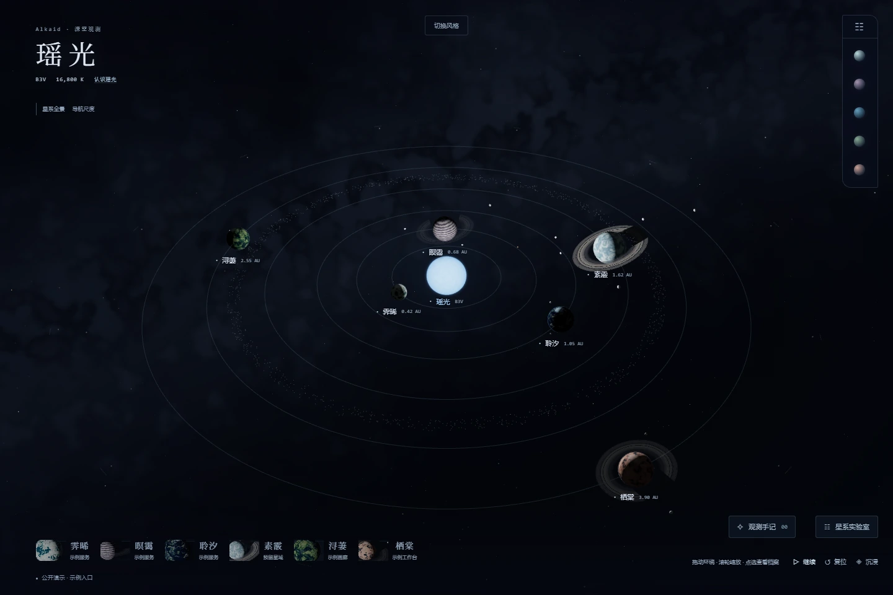
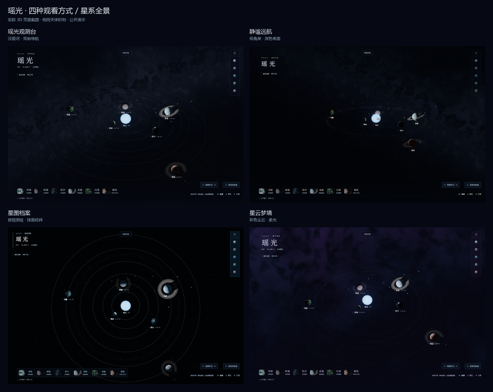

# 瑶光星系 · 3D 深空观测台

**作者：[Useradmin236](https://github.com/Useradmin236)**

以瑶光为中心的交互式星系：六颗行星、十四颗卫星、三套环系，以及可以亲手探索的四种星象。使用 Three.js 渲染，页面无需构建，脚本、字体和纹理均随项目提供。



## 快速体验

需要 Python 3.10+ 和支持 WebGL 的现代浏览器。在项目目录运行：

```console
python server.py
```

打开 <http://127.0.0.1:43178>；四种风格的截图对比在 <http://127.0.0.1:43178/gallery.html>。Windows 也可以运行 `pwsh -File ./START.ps1`，加上 `-Gallery` 直接打开对比页。

页面通过 ES modules 加载，请使用 HTTP 服务访问。浏览器建议开启硬件加速；WebGL 不可用时仍可浏览文字档案和示例入口。

## 在星系中漫游

- 点击行星查看档案，再选择「前往」进入近景；底部六张肖像和右上位置图可以直接换星。
- 拖动环绕，滚轮缩放；手机支持单指环绕和双指缩放。卫星也可以单独查看。
- `Esc` 逐层返回，瑶光标志回到全景；暂停、复位和沉浸按钮控制观看方式。
- 星系实验室可调整时间、轨道、云量、卫星与银河，唤来彗星、流星雨、北斗连线、聆汐极光和素霰信号环。
- 四段观测手记随探索解锁，进度保存在当前浏览器中。页面尊重系统的减少动态效果设置。

| 风格 | 特征 |
| --- | --- |
| 瑶光观测台 | 淡银河、蓝白恒星、克制的界面 |
| 静谧远航 | 低角度镜头、深色夜面、暖色细节 |
| 星图档案 | 俯视构图、轨道刻度、球面经纬 |
| 星云梦境 | 蓝紫尘云、柔光、半透明档案 |



## 自定义与部署

`data.js` 定义星体、卫星、文案和示例入口。所有项目链接均使用 `example.com`，没有连接实际业务服务。素霰保留为未接入星域。天体运动与外观是艺术设定，不表示服务运行状态。

可以将 HTML、CSS、JS、`favicon.svg` 和 `vendor/` 放到任意静态托管服务；站点支持部署在子目录。详细结构、素材生成和验证方法见 [维护说明](docs/DEVELOPMENT.md)。

## 开发验证

需要 Node.js 20+。安装仅用于测试和素材生成的工具：

```console
npm ci
npx playwright install chromium
npm test
```

测试自动启动独立本地服务器，覆盖六星导航、卫星、四风格、截图解码、键盘、移动布局、复制示例地址、减少动态效果和 WebGL 降级。渲染测试串行执行；软件渲染结果不代表真实显卡帧率。

## 作者与素材许可

项目署名为 **Useradmin236**。原创代码、文档与原创素材采用 [MIT License](LICENSE) 开源，允许使用、修改、分发及商业使用，须保留版权声明与许可证。

第三方组件与素材保留各自许可：Three.js 与 simplex-noise 使用 MIT，Noto Serif SC 使用 SIL Open Font License，部分云、卫星和环纹理来自 Solar System Scope（CC BY 4.0）。来源、修改说明及许可文件见 [素材来源](vendor/ASSET-CREDITS.md)。
